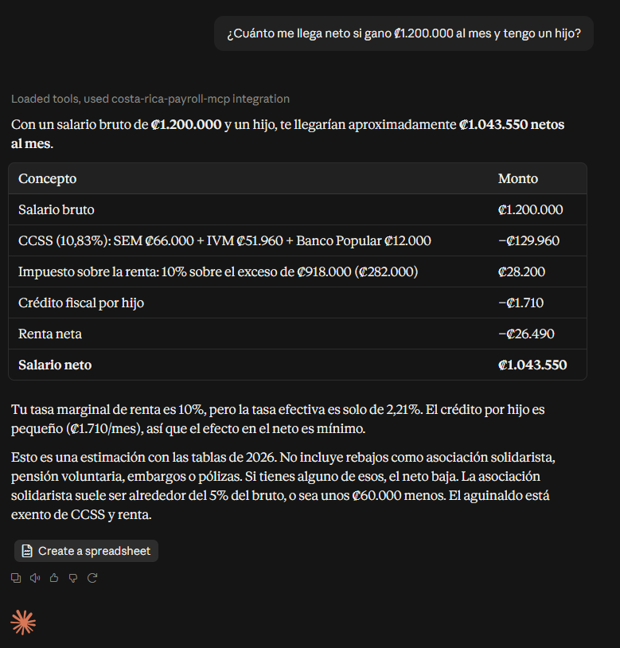

# costa-rica-payroll-mcp

An open-source [MCP](https://modelcontextprotocol.io) server that calculates Costa Rica net salary, employer payroll cost, and exposes the payroll rates currently in effect (2026).

> **Disclaimer:** This tool produces an estimate based on publicly known rates and brackets. It is **not tax advice**. Always confirm figures with CCSS, Hacienda, or a qualified accountant before making financial or legal decisions.

## Example



Asking Claude Desktop for a net salary; Claude calls `calculate_net_salary` instead of estimating.

**You ask Claude:**

> I earn ₡1,500,000 gross per month in Costa Rica, have 2 kids and a dependent spouse. What's my net salary?

**Claude (using this MCP server) answers:**

```
Net salary estimate (2026 rates)
Gross monthly salary: ₡1 500 000

CCSS (employee, 10.83%): ₡162 450
  - SEM: ₡82 500
  - IVM: ₡64 950
  - Banco Popular: ₡15 000

Income tax base: ₡1 500 000
  - 10% on ₡429 000 = ₡42 900
  - 15% on ₡153 000 = ₡22 950
Gross tax: ₡65 850
Tax credits: ₡6 010 (children: ₡3 420, spouse: ₡2 590)
Net tax: ₡59 840 (marginal rate 15%, effective rate 3.99%)

Net salary: ₡1 277 710
```

## Tools

| Tool | Description |
|---|---|
| `calculate_net_salary` | Full breakdown of CCSS, progressive income tax by bracket, tax credits, voluntary pension exemption, and resulting net salary from a gross monthly salary in CRC. |
| `calculate_employer_cost` | Employer social-charge burden and total employer cost from a gross monthly salary in CRC. |
| `get_payroll_rates` | Current income tax brackets, CCSS rates, tax credits, employer-cost rates, and their legal sources. |

### `calculate_net_salary`

| Input | Type | Default | Notes |
|---|---|---|---|
| `gross_monthly_salary` | number (CRC) | required | Must be > 0 |
| `children` | integer | 0 | Dependent children, for the tax credit |
| `has_dependent_spouse` | boolean | false | |
| `voluntary_pension` | number (CRC/month) | 0 | Exempt up to 10% of gross; excess is capped and flagged |
| `solidarity_association_pct` | number (0–8) | 0 | Percent of gross |

### `calculate_employer_cost`

| Input | Type | Default | Notes |
|---|---|---|---|
| `gross_monthly_salary` | number (CRC) | required | Must be > 0 |
| `small_non_agricultural_employer` | boolean | false | Applies the lower rate for non-agricultural employers with < 5 employees |

### `get_payroll_rates`

No input.

## Installation in Claude Desktop

Add this to your `claude_desktop_config.json`:

```json
{
  "mcpServers": {
    "costa-rica-payroll-mcp": {
      "command": "npx",
      "args": ["-y", "costa-rica-payroll-mcp"]
    }
  }
}
```

To try a local build before publishing, point it at the built file instead:

```json
{
  "mcpServers": {
    "costa-rica-payroll-mcp": {
      "command": "node",
      "args": ["C:/Claude/costa-rica-payroll-mcp/build/index.js"]
    }
  }
}
```

## Legal sources (2026)

- Decreto Ejecutivo N.° 45333-H, La Gaceta N.° 229 (2025-12-05) — monthly income tax brackets
- Ley de Protección al Trabajador, Ley N.° 7983 — CCSS contributions, voluntary pension exemption (art. 71), employer social-charge rate
- Ley del Impuesto sobre la Renta, Ley N.° 7092, art. 34 — child and spouse tax credits

Christmas bonus (*aguinaldo*) is exempt from both CCSS and income tax, and is not included in these calculations.

## Updating rates each January

All rates and brackets live in a single file: [`src/rates-2026.ts`](src/rates-2026.ts). When the annual decree changes brackets or rates:

1. Copy the file to `src/rates-<year>.ts`, update the values from the new decree.
2. Update the import in `src/payroll.ts` and `src/index.ts` to point at the new file (or rename the file in place and bump `EFFECTIVE_YEAR`).
3. Update/add tests in `src/payroll.test.ts` for the new bracket boundaries.
4. Run `npm test` and `npm run build` before publishing.

No other file should contain a hardcoded rate or bracket value.

## Development

```bash
npm install
npm run build
npm test
```

### Try it with the MCP Inspector

```bash
npm run inspector
```

Or run specific calls from the CLI:

```bash
npx @modelcontextprotocol/inspector --cli node build/index.js --method tools/call \
  --tool-name calculate_net_salary --tool-arg gross_monthly_salary=1500000
```

## Publishing (not done by this repo)

```bash
git init
git add .
git commit -m "Initial commit"
git branch -M main
git remote add origin https://github.com/<your-username>/costa-rica-payroll-mcp.git
git push -u origin main

npm login
npm publish --access public
```

## License

MIT
